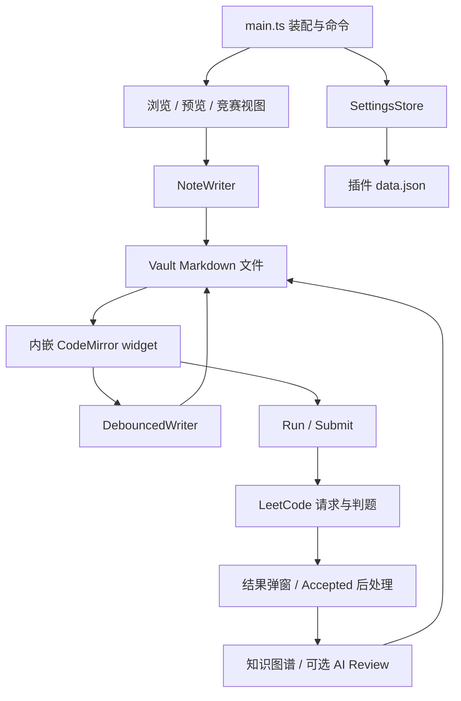
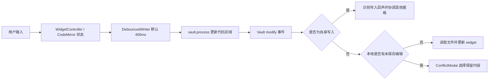

# Obsidian LeetCode 项目快速熟悉指南

> 当前独立插件为 **LeetCode Chinese 1.0.2**，ID 为 leetcode-chinese。安装、开发联接和新版市场提交以 [发布操作手册](7-发版与回滚/2026-10-20-中文插件发布操作手册.md) 为准；下文的旧版本测试记录保留用于追溯。

> 文档格式遵循 [md-output 规范](C:/Users/admin/.agents/skills/md-output/SKILL.md)。本文基于当前仓库源码整理；功能与默认值以实现为准。

> 后续改动：本地开发版已切换到力扣中国站并加入中文题目和常用界面展示。接口差异、缓存迁移及启用方式见 [力扣中国站切换与中文化说明](2026-10-20-力扣中国站切换与中文化说明.md)；下文保留原版架构说明作为项目入门背景。

[TOC]

---

## 修订记录

| 编号 | 版本 | 修订人 | 修订内容 | 日期 |
|:--:|:--|:--:|:--|:--|
| 001 | 1.0 | jie.chen | 创建项目概览、代码导航、核心流程与本地开发指南 | 2026-10-20 |

---

## 1. 先用三分钟理解项目

这是一个 **Obsidian 桌面端插件**，把 LeetCode 刷题流程放进 Obsidian：浏览题目、预览题面、生成笔记、编写代码、运行样例、提交判题，再把解题记录沉淀成可链接的知识笔记。

最常见的使用路径是：

**登录 LeetCode → 浏览题库 → 预览题目 → Start Problem 创建笔记 → 在内嵌编辑器写代码 → Run / Submit → 查看结果 → 积累解题知识。**

| 项目事实 | 当前实现 |
|:--|:--|
| 源码目录 | `C:\Users\admin\Desktop\code\obsidian-leetcode` |
| 文档基准 | Git 提交 `dbb35f2`；`package.json` 与 `manifest.json` 均为 `1.3.2` |
| 插件 ID / 名称 | `leetcode` / `LeetCode` |
| 宿主要求 | `manifest.json` 声明 Obsidian 最低 `1.12.7`，仅桌面端 |
| 技术栈 | TypeScript、Obsidian API、CodeMirror 6、esbuild、Vitest |
| UI 实现 | Obsidian View / Modal、DOM 操作、CodeMirror 扩展；没有 Vue / React 页面层 |
| 服务端 | 仓库没有独立后端，LeetCode 负责题目和判题，AI 提供商负责可选 AI 能力 |
| 数据存储 | Obsidian Vault 中的 Markdown 文件，以及插件 `data.json` |
| 构建产物 | 根目录 `main.js`，配合 `manifest.json`、`styles.css` 安装 |
| 包管理器 | 当前工作区声明 `pnpm@10.28.0` 并有 `pnpm-lock.yaml`；现有 CI 仍使用 npm 和 `package-lock.json` |

理解代码前，先记住三个约定：

1. **`src/main.ts` 是插件装配与命令入口。** 它连接各模块，也包含部分业务编排，不宜第一次就从头逐行读完。
2. **题目 Markdown 文件是持久化依据。** 编辑中的最新代码位于 widget 的 CodeMirror 状态，写入文件后成为持久数据。
3. **LeetCode 网络与 AI 网络分开。** 前者统一接入 Obsidian `requestUrl`，后者通过独立 AI 客户端和 provider 适配器。

---

## 2. 按这个顺序阅读，快速建立全貌

| 顺序 | 建议时间 | 阅读内容 | 读完要能回答的问题 |
|:--:|:--|:--|:--|
| 1 | 5 分钟 | [README](../README.md)、[manifest.json](../manifest.json)、[package.json](../package.json) | 插件给谁用，怎么安装，有哪些开发命令？ |
| 2 | 5 分钟 | [NoteTemplate.ts](../src/notes/NoteTemplate.ts)、[SettingsStore.ts](../src/settings/SettingsStore.ts) 的 `DEFAULT_DATA` | 一道题最终存成什么样，哪些设置默认开启？ |
| 3 | 10 分钟 | [main.ts](../src/main.ts) 的 `onload`、`openProblem`，以及 [NoteWriter.ts](../src/notes/NoteWriter.ts) 的 `openProblem` | 插件如何启动，点击题目后如何生成笔记？ |
| 4 | 10 分钟 | [WidgetController.ts](../src/widget/WidgetController.ts)、[debouncedWriter.ts](../src/widget/debouncedWriter.ts) | 编辑器的内容如何保存，如何处理外部修改？ |
| 5 | 10 分钟 | `main.ts` 的 `submitFromWidget`、`submitWithCode`，以及 [submissionOrchestrator.ts](../src/solve/submissionOrchestrator.ts) | 从点击 Submit 到判题结果经过哪些步骤？ |

接手具体需求时，再沿第 8 节的导航表阅读对应模块和测试。源码里的 `Phase`、`D-xx`、`Plan` 是历史开发阶段与决策编号；它们有助于追溯背景，但不能代替当前函数实现。

---

## 3. 目录与模块地图

```text
obsidian-leetcode/
├─ src/
│  ├─ main.ts       插件生命周期、依赖装配、命令和跨模块编排
│  ├─ main/         编辑器语言/主题、区段保护、文件打开与迁移等辅助逻辑
│  ├─ auth/         内嵌登录窗口、手动 Cookie 登录、会话管理
│  ├─ api/          LeetCode 客户端、requestUrl 适配、限流
│  ├─ browse/       题库视图、题目索引、筛选、快速搜索
│  ├─ preview/      只读题目预览、预览标签页复用
│  ├─ notes/        Markdown 模板、HTML 转换、文件生成和题面刷新
│  ├─ widget/       内嵌代码编辑器、写入、同步、冲突与旧笔记迁移
│  ├─ solve/        Run / Submit、判题轮询、结果弹窗、语言与代码提取
│  ├─ graph/        技巧链接、模式聚类、知识汇总笔记、历史提交
│  ├─ ai/          AI 客户端、提示词、流式弹窗、供应商与凭据适配
│  ├─ contest/     竞赛列表、练习会话、倒计时、临时笔记和赛后汇总
│  ├─ settings/    配置模型、持久化、设置页面
│  ├─ shared/      错误类型、日志脱敏、计时器工具
│  └─ types/       补充类型声明
├─ tests/          按业务模块划分的 Vitest 测试与 fixtures
├─ scripts/        网络隔离、包体积、发布前等检查脚本
├─ .github/workflows/  CI 与 GitHub Release 工作流
├─ .planning/      历史规划资料，查背景时按需阅读
├─ docs/           项目文档与 README 使用的截图
├─ styles.css      插件样式
└─ esbuild.config.mjs  单文件插件构建配置
```



---

## 4. 核心流程怎么走

### 4.1 插件启动与登录

`LeetCodePlugin.onload()` 的关键顺序是：

1. `SettingsStore.load(this)` 读取并校验已保存配置。
2. `installRequestUrlFetcher()` 替换 LeetCode SDK 的请求实现。
3. 创建 `LeetCodeClient`，尝试恢复已保存会话。
4. 创建 `AuthService`、`ProblemListService`、`NoteWriter`，随后装配知识图谱、竞赛等服务。
5. 注册视图、命令、设置页、widget 渲染器与文件事件。

**请求适配器必须先于 LeetCode 客户端安装**：SDK 凭据初始化可能立即发起网络请求。改启动代码时要保留这个依赖顺序。

登录入口在 [AuthService.ts](../src/auth/AuthService.ts)。用户可以通过内嵌窗口登录，或手动填写 Cookie。设置通过 `Plugin.loadData()` / `saveData()` 保存在插件 `data.json`。

### 4.2 选题、预览与生成笔记

- `ProblemListService` 获取题库索引并缓存，索引 TTL 为 **24 小时**，请求分页大小为 **50**。
- 默认单击题目进入只读预览；Shift 单击直接打开题目笔记。点击行为可以在设置中修改。
- `previewRouter.openOrReusePreview()` 复用已有预览标签页，预览本身不创建题目 Markdown 文件。
- 点击 `Start Problem` 后进入创建/打开笔记流程，主要实现是 `NoteWriter.openProblem()`。
- 新笔记先获取题目详情，再转换 HTML、生成正文、写入 frontmatter；获取详情失败会提示错误，不继续创建新笔记。
- 已存在且有缓存定位信息的笔记优先立即打开；详情缓存超过 **7 天**时后台刷新，刷新失败不阻止阅读已有内容。

“可离线阅读”主要指已经落盘的笔记；首次获取题目、运行和提交仍依赖网络。

### 4.3 编辑与同步：最需要理解的部分

v1.3 使用固定的 `leetcode-solve` fenced code block 渲染内嵌编辑器。语言由 frontmatter 中的 **`lc-language`** 指定，而不是从 fence 标签读取。



| 关键文件 | 为什么需要它 |
|:--|:--|
| [WidgetController.ts](../src/widget/WidgetController.ts) | 管理编辑器实例、脏状态、刷新和销毁 |
| [codeBlockProcessor.ts](../src/widget/codeBlockProcessor.ts) | 阅读模式代码块渲染入口 |
| [liveModeViewPlugin.ts](../src/widget/liveModeViewPlugin.ts)、[liveModeBannerStateField.ts](../src/widget/liveModeBannerStateField.ts) | 编辑模式挂载及 decoration/state 协作 |
| [debouncedWriter.ts](../src/widget/debouncedWriter.ts) | 防抖持久化与强制 flush |
| [selfWriteSuppression.ts](../src/widget/selfWriteSuppression.ts) | 用内容哈希识别自己的写入，避免误判成外部冲突 |
| [widgetRegistry.ts](../src/widget/widgetRegistry.ts)、[peerSyncRouting.ts](../src/widget/peerSyncRouting.ts) | 同文件多窗格的实例管理与同步路由 |
| [applyAuthoritativeBody.ts](../src/widget/applyAuthoritativeBody.ts) | 重置、复制历史代码、切换语言等程序写入所复用的协调逻辑 |
| [fenceMigrator.ts](../src/widget/fenceMigrator.ts) | 旧笔记迁移到 v1.3 fence 格式 |

修改代码区域时，不能只考虑“文件最终写对了”：还要保持 widget 状态、其他窗格、自写入识别和撤销历史一致。优先复用已有写入入口。

### 4.4 Run、Submit 和 Accepted 后处理

**Run** 用于运行样例或自定义输入，相关入口为 `runFromWidget`、`runWithCode`、`RunModal` 和 `leetcodeRest.interpretSolution`。

**Submit** 的主路径：

```text
widget 点击 Submit
→ main.ts: submitFromWidget（先 flush，再读取 widget 当前代码）
→ main.ts: submitWithCode
→ SubmissionOrchestrator
→ leetcodeRest 发起提交
→ pollSubmission 查询判题结果
→ VerdictModal 展示结果
→ Accepted 时进入 KnowledgeGraphWriter.onAccepted
→ 根据配置执行 AI Review 等后处理
```

判题轮询首次立即执行，随后按 1 / 2 / 4 / 8 秒间隔退避，之后维持 8 秒；调度层设置 60 秒预算，并处理连续请求失败与取消。细节见 [pollingOrchestrator.ts](../src/solve/pollingOrchestrator.ts)，不要依据旧注释中的其他时长修改行为。

Accepted 后会更新完成状态、语言和题目标签。`applySolveTimeFrontmatter()` 当前已不再写入完成日期、运行时间和内存字段，旧注释中的字段数量不能作为依据。技巧链接与汇总笔记由 `KnowledgeGraphWriter`、`PatternClusterEngine`、`ClusterHubWriter` 协作完成，受自动反向链接和 AI 配置影响。知识图谱写入不应改动用户的解题代码。

### 4.5 AI 与竞赛属于扩展流程

AI 相关能力包括解题辅助、失败结果分析、AC 后 Review、知识分类和竞赛分析。入口集中在 `main.ts`，统一调用 [AIClient.ts](../src/ai/AIClient.ts)，provider 分派见 [providers/index.ts](../src/ai/providers/index.ts)。

已实现 Anthropic、OpenAI、OpenRouter、Ollama、自定义兼容接口和 AWS Bedrock。流式请求包含浏览器 fetch、Electron transport 和缓冲响应降级路径；弹窗侧也参与处理流消费失败。排查时应同时看 `AIClient` 与 `AIStreamModal`。

竞赛模块的阅读顺序是 `ContestListService` → `ContestPreview` → `ContestSessionManager` → `ContestSolveView` → `ContestFinalizer`。会话管理负责开始、暂停、恢复、判题状态和倒计时；结束时生成题目记录与汇总，对未完成且已生成记录的题目添加 `revisit` 标签。

---

## 5. 数据存在哪里，哪些字段不能随便改

### 5.1 两类持久化数据

以下路径均相对于用户的 Obsidian Vault；它们不是本源码仓库中的文件。

| 数据 | 默认位置 / 归属 | 实现入口 |
|:--|:--|:--|
| 题目笔记 | `LeetCode/{id}-{slug}.md`，例如 `LeetCode/1-two-sum.md` | `NoteWriter`、`NoteTemplate` |
| 技巧笔记 | 默认 `LeetCode/Techniques`，允许单独覆盖目录 | `SettingsStore.getTechniquesFolder()`、`graph/` |
| 竞赛汇总 | `LeetCode/Contests/{date}-{contestSlug}.md` | `ContestFinalizer` |
| 登录、设置、题目/竞赛缓存、AI 配置、竞赛会话 | 默认 `.obsidian/plugins/leetcode/data.json` | `SettingsStore` |
| 运行弹窗临时状态、最近判题等 | 进程内存，不应当作长期存储 | `EphemeralTabStore`、`LastVerdictStore` |
| 旧笔记迁移备份 | 当前生成路径为 `.obsidian/plugins/obsidian-leetcode/migration-backup-.../` | `fenceMigrator`、`migrationBackupGc` |

插件安装 ID 是 `leetcode`，迁移备份目录使用的却是 `obsidian-leetcode`。另外，备份创建函数与部分扫描逻辑对 `configDir` 的处理并不完全一致；使用自定义 Obsidian 配置目录时，应核对实际备份位置，不要直接套用安装目录。清理逻辑设定为清理超过 30 天的迁移备份。

Cookie 和 AI key 会写入本机插件配置；`data.json` 不是加密凭据库。调试时不要把真实文件内容提交进仓库或粘贴进日志。

### 5.2 题目笔记示意

下面仅展示核心字段，标题、题面和代码均为示意：

````markdown
---
lc-id: 1
lc-slug: two-sum
lc-title: Two Sum
lc-difficulty: Easy
lc-url: https://leetcode.com/problems/two-sum/
lc-status: untouched
lc-language: python3
aliases:
  - Two Sum
  - "1"
tags:
  - lc/easy
---
# Two Sum
## Problem
题目内容……

## Code

```leetcode-solve
class Solution:
    pass
```

## Notes

自己的解题思路……
````

- 文件名里的 `id` 是展示题号；提交请求还涉及 LeetCode 内部 question ID，二者不能直接混用。
- `lc-status` 持久化取值为 `accepted / attempted / untouched`；题库内部还有 `solved`，映射在 `NoteTemplate.mapStatusDisplay()`。
- `lc-slug` 是识别题目笔记的重要入口；`lc-language` 控制代码语言。
- `aliases`、`tags` 写入时会合并已有用户内容；`lc-*` 由插件维护，并对已有完成状态做保留处理。
- 新笔记基础正文是 `Problem / Code / Notes`；`Techniques / Related Variants / AI Review` 等按功能写入，不是每篇初始就有。
- 父 Markdown 编辑器的保护范围看 `sectionProtectionExtension.ts` 的 `computeLockedRanges()`：包含题面、标题区域、`Code` 区域及部分章节标题。v1.3 的代码区域在父编辑器中受保护，用户通过内嵌 widget 编辑；不要把这理解为代码本身不能修改。README 与部分旧注释中的“仅保护题面和 Techniques 标题”描述并不完整。

### 5.3 最值得记住的默认设置

| 设置 | 默认值 |
|:--|:--|
| 题目目录 / 默认语言 | `LeetCode` / `python3` |
| 题目点击行为 | 先预览 |
| widget 写入防抖 | 400ms |
| 打开旧笔记时自动迁移 | 开启 |
| 自动技巧反向链接 | 开启 |
| 当前 AI provider | 未选择，即 `null` |
| AC 后自动 AI Review | 关闭 |
| 自动 AI 知识分类 | 开启，但仍依赖 provider、授权等条件 |
| 自动 AI 竞赛分析 | 关闭 |

默认值的唯一核对入口是 [SettingsStore.ts](../src/settings/SettingsStore.ts) 的 `DEFAULT_DATA`。

---

## 6. 在 Windows 上开发与验证

### 6.1 安装依赖与构建

仓库 CI 使用 **Node.js 22**。本地按相同 Node 版本准备环境，并按当前 `packageManager` 声明使用 **pnpm 10.28.0**：

```powershell
Set-Location 'C:\Users\admin\Desktop\code\obsidian-leetcode'
node -v
pnpm install --frozen-lockfile
pnpm build
```

`pnpm build` 先执行 TypeScript 检查，再由 esbuild 生成压缩后的 CommonJS `main.js`。Obsidian、Electron 和部分 CodeMirror 模块是 external，由宿主提供。

本次整理期间，工作区新增了 pnpm 声明与锁文件，既有 `.github/workflows/ci.yml` 仍执行 `npm ci`。因此，本地按声明使用 pnpm；复现现有 CI 时使用 `npm ci` 和对应 npm 命令。两套锁文件与 CI 的统一需要后续单独处理，本文没有修改这些配置。

日常开发运行：

```powershell
pnpm dev
```

这是 **esbuild watch**，输出根目录 `main.js`；不会启动网页服务器，也不会自动把插件复制进 Vault。

### 6.2 装到 Obsidian 测试库

把构建后的 `main.js`、仓库的 `manifest.json` 和 `styles.css` 放到测试 Vault 的 `.obsidian/plugins/leetcode/`，然后在 Obsidian 中启用或重新加载插件。

下面的 `$vaultRoot` 必须替换为真实的测试库绝对路径：

```powershell
$vaultRoot = 'D:\Obsidian测试库'
$pluginDir = Join-Path $vaultRoot '.obsidian\plugins\leetcode'
New-Item -ItemType Directory -Force -Path $pluginDir | Out-Null
Copy-Item -LiteralPath '.\main.js', '.\manifest.json', '.\styles.css' -Destination $pluginDir -Force
```

第一次体验可按“登录 → 浏览题库 → 预览 → Start Problem → 修改代码 → Run → Submit”走一遍，再切换阅读/编辑模式和分屏，观察代码是否一致。AI 需要单独配置，理解基础流程时可以先跳过。

### 6.3 检查命令与环境限制

| 命令 | 用途 |
|:--|:--|
| `pnpm test` | 运行 Vitest 测试 |
| `pnpm test tests/solve/submissionOrchestrator.test.ts` | 运行指定测试文件 |
| `pnpm test tests/widget` | 只运行 widget 相关测试 |
| `pnpm run check:lc-isolation` | 显式执行 LeetCode 网络隔离检查 |
| `pnpm lint` | 执行 ESLint；是否自动执行 `prelint` 取决于 pnpm 配置 |
| `pnpm build` | TypeScript 检查与生产打包 |
| `pnpm run check:bundle-size` | 检查已生成的 `main.js` 体积 |
| `pnpm run ci` | 当前脚本内部仍调用 npm，按 lint → test → build → bundle-size 执行 |

`npm run lint` 会自动执行 `prelint`；使用 pnpm 时可先显式运行 `pnpm run check:lc-isolation`，避免依赖生命周期钩子的配置差异。网络隔离检查调用 Bash，Windows 上需要 Git Bash 等环境，并确保 `bash` 能从当前终端调用。`grep:vault`、`prerelease-check.sh` 也属于 shell 脚本，不应直接当 PowerShell 脚本执行。

测试使用 **Vitest + happy-dom**，`obsidian` 被映射到 [obsidian-stub.ts](../tests/helpers/obsidian-stub.ts)，Vault 与网络也有模拟实现。因此单元测试通过不能替代真实 Obsidian 内的编辑、分屏、主题和登录验证。

包体积门槛以 [check-bundle-size.mjs](../scripts/check-bundle-size.mjs) 为准：超过 **1,760,000 bytes** 警告，超过 **1,800,000 bytes** 失败。CI 在 Ubuntu 上执行检查；Release 工作流响应版本号标签，构建并上传插件文件。

---

## 7. 修改前先守住这些约定

1. **题目 schema 集中在 `NoteTemplate.ts`。** 新增字段、标题或改命名规则前先查这里，避免多处定义不一致。
2. **文本变换尽量保持纯函数。** `vault.process` 回调可能重试，回调内不应额外触发网络请求或其他不可重复副作用。
3. **写代码区域要复用同步逻辑。** 重置、语言切换、历史代码复制尤其要检查 `applyAuthoritativeBody`、flush 和多窗格路径。
4. **LeetCode 请求不能混入 AI transport。** 修改网络代码后关注 `tests/ai/lc-isolation.test.ts` 与 `scripts/check-no-*.sh`。
5. **编辑器生命周期必须配对。** 新增监听器、计时器、EditorView 时，同时检查销毁、切换文件和插件卸载路径。
6. **离线、登录过期、限流和未知 verdict 是已有分支。** 优先复用 `shared/errors.ts` 与现有提示、结果映射，不新增平行处理链。
7. **不要把注释中的旧架构当作当前实现。** 当前入口已采用 v1.3 widget，但部分函数注释仍保留旧阶段的术语和约束。

---

## 8. 接到需求或问题时，去哪里找

| 需求 / 现象 | 优先阅读代码 | 对应测试入口 |
|:--|:--|:--|
| 题库搜索、筛选、题目状态异常 | `browse/ProblemBrowserView.ts`、`ProblemListService.ts`、`FilterModal.ts` | `tests/browse/`、`search-filter.test.ts`、`problem-filter-status.test.ts` |
| 点击题目行为、预览页复用 | `preview/previewRouter.ts`、`ProblemPreviewView.ts` | `tests/preview/` |
| 笔记路径、模板、标签、题面刷新 | `notes/NoteWriter.ts`、`NoteTemplate.ts`、`HeadingRegion.ts` | `tests/note-*.test.ts`、`offline-regenerate.test.ts` |
| 代码保存、分屏冲突、光标跳动 | `widget/WidgetController.ts`、`debouncedWriter.ts`、`peerSyncRouting.ts`，以及 `main.ts` 的 modify 监听 | `tests/widget/` |
| 语法高亮、缩进、Vim、语言切换 | `main/childEditorLanguage.ts`、`main/runLanguageSwitch.ts`、`widget/vimMode.ts` | `tests/main/childEditor*`、`tests/widget/language*`、`vim*.test.ts` |
| Run / Submit 结果或超时问题 | `solve/leetcodeRest.ts`、`submissionOrchestrator.ts`、`pollingOrchestrator.ts`、`statusMap.ts` | `tests/solve/` |
| 登录过期、请求失败或限流 | `auth/`、`api/requestUrlFetcher.ts`、`api/throttle.ts` | `tests/api/`、`session-expiry.test.ts` |
| AC 后技巧链接与知识汇总异常 | `graph/KnowledgeGraphWriter.ts`、`PatternClusterEngine.ts`、`ClusterHubWriter.ts` | `tests/graph/` |
| AI 配置、流式结果、取消或降级 | `ai/AIClient.ts`、`AIStreamModal.ts`、`providers/` | `tests/ai/` |
| 竞赛计时、恢复、赛后笔记 | `contest/ContestSessionManager.ts`、`ContestFinalizer.ts` | `tests/contest/` |
| 新增设置项或调整默认值 | `settings/SettingsStore.ts`、`SettingsTab.ts` | `tests/settings/`、`settings-store.test.ts` |

搜索示例：

```powershell
rg -n 'submitFromWidget|submitWithCode|onAccepted' src/main.ts
rg -n 'lc-language|lc-status' src/notes src/widget src/solve
rg -n 'forceFlush|reloadFromDisk|modify' src/widget src/main.ts
```

---

## 9. 本次文档的核验范围

已对照源码核查项目版本、启动顺序、配置默认值、笔记创建、widget 写入、提交链路、AI 适配、竞赛收尾、构建配置和 CI 命令，并校验本文仓库相对链接。

本次仅新增此文档，没有安装依赖、运行 lint / 测试 / 构建，也没有连接真实 LeetCode、AI 服务或启动 Obsidian。整理开始时没有 `node_modules`，期间工作区出现了依赖目录与 pnpm 配置变更，本文已同步说明包管理器现状。文档中的运行命令是后续操作指引，不代表这些验证已通过。

---

## 参考资料

- [项目 README 与界面截图](../README.md)
- [版本变更记录](../CHANGELOG.md)
- [插件生命周期与命令入口](../src/main.ts)
- [笔记结构定义](../src/notes/NoteTemplate.ts)
- [配置与持久化实现](../src/settings/SettingsStore.ts)
- [CI 工作流](../.github/workflows/ci.yml)
- [发布工作流](../.github/workflows/release.yml)
